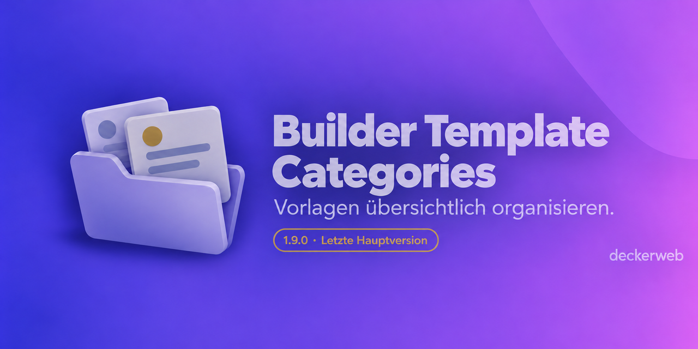

# Builder Template Categories

> **Entwicklung eingestellt**
> Die Entwicklung von Builder Template Categories wurde mit Version 1.9.0 eingestellt. Das Plugin ist überholt: Seine ursprünglichen Aufgaben übernehmen heute WordPress und moderne Builder; zugleich haben sich die Arbeitsabläufe verändert. Falls nötig, erscheinen ausschließlich Sicherheitsupdates — längstens bis zum 31.12.2027.

Entdecke stattdessen insbesondere **[Builder Content Guide](https://github.com/deckerweb/builder-content-guide)** und die weiteren Builder-Helfer unten.

Gemeinsame Projektkategorien für unterstützte Vorlagenbibliotheken im WordPress-Admin.

**Version:** 1.9.0 · **WordPress:** 7.0+ · **PHP:** 8.0+ · **GPL-2.0-or-later**

[Anleitung](docs/guide-de.md) · [English](README.md) · [FAQ](#faq) · [Sicherheit](SECURITY.md)

## Builder-Kategorien und WordPress-Vorlagen-Kategorien

**Builder-Kategorien** ist die gemeinsame Taxonomie dieses Plugins für unterstützte Vorlagenbibliotheken. **Vorlagen-Kategorien** ist die separate WordPress-Taxonomie für gespeicherte Patterns. Im Vorlageneditor können beide erscheinen. Die neue Bezeichnung verändert weder Taxonomie-Kennungen noch vorhandene Zuordnungen; beide Systeme werden nicht automatisch synchronisiert.

## Auf einen Blick

- Eine gemeinsame Taxonomie für die verbleibenden Vorlagenbibliotheken.
- Kategorien filtern und per Mehrfachbearbeitung zuweisen.
- Deutsche und englische Beschriftungen auch im Block-Editor.
- Keine Frontend-Ausgabe und keine externen Aufrufe des Kernplugins.

## Installation und Nutzung

1. ZIP unter **Plugins → Installieren → Plugin hochladen** installieren.
2. Aktivieren und die Vorlagenbibliothek öffnen.
3. Im Untermenü **Builder-Kategorien** die gewünschten Kategorien anlegen.
4. In der Vorlagenübersicht Kategorien zuweisen und über das Dropdown filtern.

## Verbleibende Integrationen

WordPress user patterns (`wp_block`), Elementor, Bricks, Beaver Builder / Beaver Themer, Divi, Oxygen Classic, Avada, GeneratePress Elements, Astra Pro.

Unterstützt wird die WordPress-Admin-Organisation. Kategorien werden nicht automatisch in die native Bibliothek eines Builders übernommen. Oxygen 6 ist nicht enthalten. Integrationseinträge werden nur für vorhandene Beitragstypen registriert.

## Update auf 1.9.0

72 frühere Integrationsdateien entfallen, darunter Formulare, Felder, Snippets, Scripts, kleinere Themes und Builder-Add-ons. Bestehende Zuordnungen bleiben gespeichert. Bei Bedarf kann ein Entwickler die bestehende Integrationsschnittstelle verwenden. Die Entfernung ist kein automatischer Datenumzug.

## FAQ

### Warum endet die Entwicklung?

WordPress und moderne Builder bieten heute eigene Bibliotheken und Organisationsfunktionen. Das Plugin wird mit 1.9.0 funktional abgeschlossen.

### Gibt es noch Updates?

Nur erforderliche Sicherheitsupdates, längstens bis 31.12.2027. Neue Funktionen sowie allgemeine Kompatibilitäts- und Fehlerkorrekturen sind danach nicht geplant.

### Was passiert mit meinen Kategorien?

Vorhandene Kategorien und Zuordnungen bleiben erhalten, auch bei Deaktivierung oder Deinstallation. Für entfernte Integrationen fehlt die Oberfläche; die Zuordnungen werden nicht gelöscht.

### Was muss ich vor dem Update prüfen?

Sichere Datenbank und Plugin-Dateien. Prüfe die höheren Mindestversionen und ob deine Integration weiterhin enthalten ist. Teste die Aktualisierung zuerst auf einer Testwebsite.

### Wer darf Kategorien verwenden?

Standardmäßig Benutzer mit edit_theme_options. Die Berechtigung ist filterbar. Öffentliche Besucher und normale Redakteure können interne Kategorien nicht über REST lesen oder ändern.

### Ersetzt Builder Content Guide dieses Plugin?

Es ist ein eigenständiges Plugin für verständliche Bearbeitungshinweise und Verweise auf Website-Bausteine. Es gibt keine automatische Migration der Kategorien.

### Funktioniert Multisite?

Einzel- und Netzwerkaktivierung werden unterstützt. Jede Website hat ihre eigenen Kategorien; neue Websites werden bei aktiver Netzwerkfreigabe initialisiert.

Die vollständige Anleitung einschließlich Entwicklerhinweisen steht in der [Dokumentation](docs/guide-de.md).

## Changelog

### 1.9.0 — 2026-10-10

**Verbessert:** Auf neun Integrationsdateien reduziert; veraltete Menüs und Eingriffe in andere Plugins entfernt.

**Behoben:** Beschriftungen im Block-Editor und in REST, Berechtigungen, Fehler bei ungültigen Kategorie-IDs, sichere Spaltenausgabe und Multisite-Initialisierung.

**Sonstiges:** Mindestversionen WordPress 7.0 / PHP 8.0. Entwicklung beendet; mögliche Sicherheitsupdates bis spätestens 31.12.2027.

[Vollständige Historie](CHANGELOG-de.md).

## Weitere Builder-Plugins

- [Builder Content Guide](https://github.com/deckerweb/builder-content-guide)
- [Builder Shortcode Extras](https://github.com/deckerweb/builder-shortcode-extras)
- [Bricks QuickNav](https://github.com/deckerweb/bricks-quicknav)
- [Breakdance QuickNav](https://github.com/deckerweb/breakdance-quicknav)

## Projekt und Sicherheit

Von David Decker — DECKERWEB, seit 2018. Sicherheitslücken bitte vertraulich gemäß [SECURITY.md](SECURITY.md) melden. Unterstützung: [Ko-fi](https://ko-fi.com/deckerweb), [Buy Me a Coffee](https://buymeacoffee.com/daveshine), [PayPal](https://paypal.me/deckerweb).

Copyright © 2018–2026 David Decker — DECKERWEB. GPL-2.0-or-later. [License](LICENSE).

Grafiken: behutsame Überarbeitung der bestehenden Motive mit OpenAI ImageGen. Historische Ordner-Icons: Tabler Icons / Paweł Kuna, MIT. Neue SVG-Dateien enthalten die freigegebenen Rastergrafiken; sie sind keine neu gezeichneten Vektoren.

Gespeicherte WordPress-Vorlagen sind direkt unter **Vorlagen** im Admin-Menü erreichbar: **Alle Vorlagen**, **Vorlage hinzufügen** und **Builder-Kategorien**. Nur von Themes oder Plugins bereitgestellte Patterns bleiben im nativen Vorlagen-Inserter. Es gelten weiterhin die WordPress-Bearbeitungsrechte.

Builder-Kategorien gehören zu diesem Plugin und sind unabhängig von den WordPress-Vorlagen-Kategorien. Bestehende Kategorien und Zuordnungen bleiben erhalten.

Die Verwaltung der Builder-Kategorien zeigt die auf dieser Website verfügbaren Vorlagenbibliotheken mit Links zu ihren Übersichten und aufklappbaren technischen Beitragstypen. Diese Information sehen nur Benutzer mit der Berechtigung für Builder-Kategorien.
