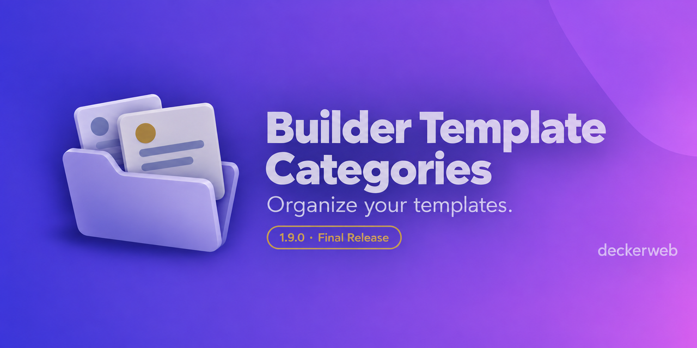

# Builder Template Categories

> **Development ended**
> Development of Builder Template Categories ended with version 1.9.0. The plugin is outdated: WordPress and modern builders now cover its original tasks, and workflows have changed. Only security updates may be released if needed, and no later than December 31, 2027.

Explore **[Builder Content Guide](https://github.com/deckerweb/builder-content-guide)** and the other builder tools linked below.

Shared project categories for supported template libraries in WordPress admin.

**Version:** 1.9.2 · **WordPress:** 7.0+ · **PHP:** 8.1+ · **GPL-2.0-or-later**

[Guide](docs/guide.md) · [Deutsch](README-de.md) · [FAQ](#faq) · [Security](SECURITY.md)

## Builder Categories and WordPress pattern categories

**Builder Categories** is this plugin’s shared taxonomy for supported template libraries. **Pattern Categories** is WordPress’s separate taxonomy for saved patterns. Both can appear in the pattern editor. Renaming our labels changes neither taxonomy identifiers nor existing assignments; the two systems are not automatically synchronized.

## At a glance

- One shared taxonomy for the retained template libraries.
- Filter and bulk-assign categories in WordPress list tables.
- Localized labels in the block editor and REST.
- No frontend output; optional catalog and native update requests are documented below.

## Installation and use

1. Upload the ZIP through **Plugins → Add Plugin → Upload Plugin**.
2. Activate and open the template library.
3. Open **Builder Categories** in the template library submenu and create your categories.
4. Assign categories and filter templates through the list-table dropdown.

## Retained integrations

WordPress user patterns (`wp_block`), Elementor, Bricks, Beaver Builder / Beaver Themer, Divi, Oxygen Classic, Avada, GeneratePress Elements, Astra Pro.

Support covers organization in WordPress admin. Categories are not automatically added to native builder-library filters. Oxygen 6 is not included. Integrations only participate when their post types exist.

## Updating to 1.9.0

72 previous integration files have been removed, including forms, fields, snippets, scripts, niche themes and builder add-ons. Existing assignments remain stored. Developers can use the existing integration filter when needed. Removal does not migrate data.

## FAQ

### Why does development end?

WordPress and modern builders provide native libraries and organization tools. Version 1.9.0 concludes feature development.

### Will there be more updates?

Only necessary security updates may follow, no later than December 31, 2027. No new features, general compatibility maintenance or routine bug fixes are planned afterward.

### What happens to my categories?

Existing categories and assignments are retained, including on deactivation and uninstall. Removed integrations lose their UI, but stored assignments are not deleted.

### What should I check before updating?

Back up your database and plugin files. Check the higher minimum versions and retained integrations. Test the update on staging first.

### Who can use categories?

Users with edit_theme_options by default. The capability is filterable. Public visitors and ordinary editors cannot read or modify internal categories through REST.

### Does Builder Content Guide replace this plugin?

It is an independent plugin for understandable editing notes and links to website components. There is no automatic category migration.

### Does it support Multisite?

Single-site and network activation are supported. Categories belong to each site; newly initialized sites are seeded when network activation is enabled.

See the [documentation](docs/guide.md) for usage and developer guidance.

## Changelog

### 1.9.2 — 2026-10-22

**Fixed:** Reliable GitHub updates when another plugin has already loaded an older deckerweb Updater.

### 1.9.1 — 2026-10-21

**Improved:** Library 1.1.0 and Updater 2.2.0 with verified package identity.
**Fixed:** Final output escaping and bundled translation fallback after locale changes.
**Misc:** PHP 8.1 minimum. This maintenance exception preserves the feature freeze and security deadline.

### 1.9.0 — 2026-10-10

**Improved:** Reduced to nine integration files; removed legacy menus and changes to unrelated plugins.

**Fixed:** Block-editor and REST labels, authorization, invalid category IDs, escaped column output and Multisite initialization.

**Misc:** Requires WordPress 7.0 / PHP 8.0. Feature development ended; possible security updates end by December 31, 2027.

[Full history](CHANGELOG.md).

## More builder tools

- [Builder Content Guide](https://github.com/deckerweb/builder-content-guide)
- [Builder Shortcode Extras](https://github.com/deckerweb/builder-shortcode-extras)
- [Bricks QuickNav](https://github.com/deckerweb/bricks-quicknav)
- [Breakdance QuickNav](https://github.com/deckerweb/breakdance-quicknav)

## Project and security

By David Decker — DECKERWEB, since 2018. Report vulnerabilities privately as described in [SECURITY.md](SECURITY.md). Support: [Ko-fi](https://ko-fi.com/deckerweb), [Buy Me a Coffee](https://buymeacoffee.com/daveshine), [PayPal](https://paypal.me/deckerweb).

Copyright © 2018–2026 David Decker — DECKERWEB. GPL-2.0-or-later. [License](LICENSE).

Artwork: existing motifs carefully updated with OpenAI ImageGen. Historical folder icons: Tabler Icons / Paweł Kuna, MIT. New SVG files embed the approved raster artwork; they are not redrawn vector illustrations.

WordPress patterns are available directly under **Patterns** in the admin menu: **All Patterns**, **Add Pattern**, and **Builder Categories**. This library contains your saved patterns; patterns supplied only by themes or plugins remain in the native pattern inserter. WordPress editing permissions still apply.

Builder Categories belong to this plugin and are independent of the native WordPress pattern categories. Existing terms and assignments are preserved.

The Builder Categories management screen lists the template libraries currently available on this website, with links to their lists and expandable post-type details. Only users permitted to manage Builder Categories can see this information.

## Maintenance update 1.9.2

Updater 2.2.1 fixes update handling when older updater copies are also loaded. Library 1.1.0, features, settings and minimum requirements remain unchanged.

## Maintenance update 1.9.1

Version 1.9.1 adds deckerweb Library 1.1.0 and deckerweb Updater 2.2.0 as a maintenance exception. PHP 8.1 or later is now required; WordPress 7.0 remains the minimum. The feature freeze and security maintenance deadline of December 31, 2027 remain unchanged.

The shared Library is available through Add Plugins; it can be hidden in Settings → deckerweb Library. Its online catalog is off by default. Enabling it retrieves a public catalog from GitHub. Installing a selected plugin downloads its approved package; activation is separate. Native updates may contact GitHub and download release ZIPs. These endpoints can see the requesting IP address; no telemetry is added. Public updates need no token.

Shared Library settings survive deactivation and remain by default after uninstall. Removing the final embedding host cleans component caches and temporary files; optional settings deletion follows the Library preference. Other installed plugins, categories and content remain.

This plugin bundles deckerweb Library 1.1.0 and deckerweb Updater 2.2.1 by David Decker – DECKERWEB under GPL-2.0-or-later. Sources: https://github.com/deckerweb/deckerweb-plugin-library and https://github.com/deckerweb/deckerweb-updater.

[Complete guide and FAQ by topic](https://github.com/deckerweb/builder-template-categories/wiki/English).
